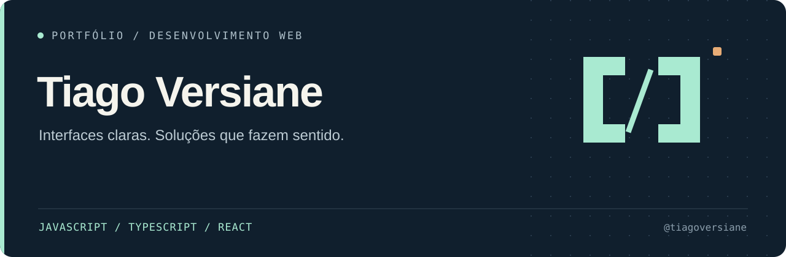

  

Construo projetos web com **JavaScript, TypeScript e React**, com atenção à clareza da interface, à organização do código e às regras de cada aplicação.

Este portfólio reúne minha evolução na prática: dos fundamentos em JavaScript a uma aplicação de gestão com múltiplos módulos em React.

[Projeto em destaque](#projeto-em-destaque) · [Estudos de JavaScript](#estudos-de-javascript) · [Tecnologias](#tecnologias-na-prática)

## Projeto em destaque

### [rota. — Gestão de locadora](https://github.com/tiagoversiane/locadora-veiculos)

Da disponibilidade dos veículos à devolução: uma aplicação acadêmica para acompanhar **frota, clientes, locações, vistorias e pagamentos**.

**React 19 · TypeScript · Vite · Bootstrap 5 · Axios · JSON Server**

- Fluxo de locação com cálculo de diárias, contrato e vistorias.
- Cadastro da frota com fotografias, preços individuais e manutenção.
- Interface para computador e celular, com galeria de telas e documentação técnica.

O login é demonstrativo; a API é local e a nota fiscal é simulada.

**[Explorar o projeto →](https://github.com/tiagoversiane/locadora-veiculos)** · [Ver as telas](https://github.com/tiagoversiane/locadora-veiculos/blob/main/docs/TELAS.md) · [Ler a documentação](https://github.com/tiagoversiane/locadora-veiculos/blob/main/docs/DOCUMENTACAO.md)

## Estudos de JavaScript

<table>
  <tr>
    <td width="50%" valign="top">
      
      <h3><a href="https://github.com/tiagoversiane/ec01-gerenciamento-alunos">Gerenciamento de alunos</a></h3>
      
Cadastro, edição, aprovação e cinco relatórios. Prática de classes, DOM e transformação de dados com <code>map</code>, <code>filter</code> e <code>reduce</code>.

      
<strong>JavaScript · Bootstrap 5 · Docker · Nginx</strong>

      
<a href="https://tiagoversiane.github.io/ec01-gerenciamento-alunos/">Experimentar a demonstração →</a> · <a href="https://github.com/tiagoversiane/ec01-gerenciamento-alunos">Código</a>

    </td>
    <td width="50%" valign="top">
      
      <h3><a href="https://github.com/tiagoversiane/ec02-gestao-funcionarios">Gestão de funcionários</a></h3>
      
Cadastros e relatórios salariais. Prática de encapsulamento com campos privados, getters, setters e operações sobre coleções.

      
<strong>JavaScript · Bootstrap 5 · Docker · Nginx</strong>

      
<a href="https://tiagoversiane.github.io/ec02-gestao-funcionarios/">Experimentar a demonstração →</a> · <a href="https://github.com/tiagoversiane/ec02-gestao-funcionarios">Código</a>

    </td>
  </tr>
</table>

Os dois estudos mantêm os dados em memória: os cadastros são apagados ao recarregar a página.

## Tecnologias na prática

| Área | Ferramentas usadas nos projetos |
| :--- | :--- |
| Interfaces | JavaScript, TypeScript, React, HTML, CSS e Bootstrap |
| Integração | Axios e API local com JSON Server |
| Ambiente | Vite, Docker e Nginx |

Cada repositório apresenta seu escopo, as decisões de implementação e as instruções para executar localmente.
